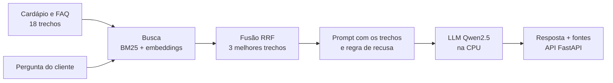

<div align="center">

# Assistente de atendimento com LLM e RAG para uma pizzaria fictícia (PT-BR)

**Um assistente que responde perguntas de clientes a partir de documentos, usando RAG, e mede o quanto a busca e a geração acertam.**

[](https://www.python.org/)
[](https://fastapi.tiangolo.com/)
[](https://www.docker.com/)
[](https://huggingface.co/Qwen/Qwen2.5-1.5B-Instruct)
[-83%2C3%25-brightgreen)](#resultados-da-busca)
[](#notas-importantes)
[](#licenças-e-créditos)

[Como usar](#como-usar) · [Resultados da busca](#resultados-da-busca) · [Resultados da geração](#resultados-da-geração) · [Análise de erros](#análise-de-erros) · [Limitações](#limitações)

</div>

---

## Sumário

- [Sobre o projeto](#sobre-o-projeto)
- [Características principais](#características-principais)
- [Como usar](#como-usar)
- [Como funciona](#como-funciona)
- [Estrutura do projeto](#estrutura-do-projeto)
- [Tecnologias utilizadas](#tecnologias-utilizadas)
- [Resultados da busca](#resultados-da-busca)
- [Resultados da geração](#resultados-da-geração)
- [Análise de erros](#análise-de-erros)
- [Exemplos de uso](#exemplos-de-uso)
- [Notas importantes](#notas-importantes)
- [Limitações](#limitações)
- [Licenças e créditos](#licenças-e-créditos)
- [Autora](#autora)

---

## Sobre o projeto

Um LLM sozinho não conhece o cardápio nem as regras de um restaurante e, se perguntado, inventa. Este projeto usa **RAG** (*Retrieval-Augmented Generation*, geração aumentada por busca): primeiro procura os trechos dos documentos relacionados à pergunta e só então pede ao LLM que responda usando apenas esses trechos. É como uma prova com consulta.

As perguntas que ele responde são duas: qual busca encontra melhor a seção certa, entre **BM25** (palavras, ML clássico), **embeddings** (significado, deep learning) e uma **busca híbrida**; e se um LLM pequeno consegue responder só com o que está escrito e **recusar o que não está**.

### Resultado em uma olhada

| Busca (24 perguntas com resposta) | Top-1 | Top-3 | MRR |
|---|:---:|:---:|:---:|
| BM25 | **0,792** | 0,792 | **0,822** |
| Embeddings (MiniLM) | 0,542 | 0,792 | 0,688 |
| Híbrida (RRF) | 0,667 | **0,833** | 0,773 |

| Geração (Qwen2.5-1.5B, prompt v2) | Resultado |
|---|:---:|
| Respostas corretas / parciais / erradas (24 perguntas) | **14** / 4 / 6 |
| Recusa das 3 perguntas sem resposta originais | 2 de 3 |
| Recusa de 3 perguntas novas sem resposta | 3 de 3 |

> Avaliação em 27 perguntas sobre 18 trechos de um restaurante fictício. Os números mostram o comportamento nesse conjunto e não valem como medida geral de qualidade de RAG.

---

## Características principais

- ✅ **RAG completo**: busca, montagem do prompt e geração, com as **fontes** de cada resposta
- ✅ **Três buscas comparadas** no mesmo conjunto: BM25 em Python puro, embeddings multilíngues e híbrida (RRF)
- ✅ Perguntas **diretas e parafraseadas**, para mostrar onde cada busca erra
- ✅ **Recusa** de perguntas sem resposta nos documentos, testada com 6 perguntas
- ✅ LLM pequeno open source rodando na **CPU**, sem chave de API
- ✅ **API FastAPI** com `POST /perguntar` e `GET /health`, com os modelos carregados uma vez
- ✅ Empacotado com **Docker**
- ✅ Respostas avaliadas em **três níveis**, com a causa de cada erro (busca ou LLM)
- ✅ Versões das bibliotecas fixadas no `requirements.txt`

---

## Como usar

### Usar a API

**1. Instale as dependências e suba o servidor**

```bash
python -m venv .venv && source .venv/bin/activate
pip install -r requirements.txt
uvicorn app.main:app --port 8000
```

Na primeira subida os modelos são baixados do Hugging Face, e isso demora. Quando aparecer `Application startup complete`, abra `http://localhost:8000/docs`.

**2. Faça uma pergunta**

```bash
curl -X POST http://localhost:8000/perguntar -H "Content-Type: application/json" \
     -d '{"pergunta": "Qual o prazo do reembolso?"}'
# {"resposta": "...", "fontes": [{"arquivo": "faq.md", "secao": "Reembolso", "score": 0.0328}]}
```

O `score` é o da fusão RRF (valores pequenos, em torno de 0,03).

> [!IMPORTANT]
> O LLM padrão (Qwen2.5-1.5B) ocupa cerca de 6 GB de RAM em float32. Com pouca memória, use o modelo menor, que é mais fraco: `MODELO_LLM=Qwen/Qwen2.5-0.5B-Instruct uvicorn app.main:app --port 8000`.

### Usar com Docker

```bash
docker build -t la-tavola-rag .
docker run --rm -p 8000:8000 -e MODELO_LLM=Qwen/Qwen2.5-0.5B-Instruct \
       -v hf-cache:/root/.cache/huggingface la-tavola-rag
```

O volume `hf-cache` guarda os modelos baixados para as próximas subidas. Sem a variável `MODELO_LLM`, usa o Qwen2.5-1.5B.

### Reproduzir os experimentos

Não precisa de GPU. Cada resposta leva cerca de 20 segundos na CPU do Kaggle.

1. Abra um notebook no Kaggle (ou no Colab) com **internet** ligada e sem GPU.
2. Envie as pastas `data` e `eval` e ajuste a variável `BASE` na célula 1.
3. Tire o `#` da linha de instalação na célula 0 e rode as células do `busca_e_avaliacao.py` em ordem. Isso gera `eval/resultados_busca.json`.
4. Para a geração, cole as células do `passo2_geracao.py` (9 a 12) depois da célula 8 e rode. Para o segundo prompt, use o `passo2b_prompt_v2.py`.
5. Testes: `pip install -r requirements-dev.txt` e `pytest tests/test_busca.py` (rápido); `pytest tests/test_api.py -s` carrega os modelos.

---

## Como funciona



| Etapa | O que acontece |
|---|---|
| **1. Documentos** | `cardapio.md` (7 seções) e `faq.md` (11 seções) de um restaurante fictício. Cada título `##` vira um trecho, num total de 18 |
| **2. Busca** | BM25 implementada à mão (k1 = 1,5; b = 0,75; sem acentos e sem palavras comuns), embeddings `paraphrase-multilingual-MiniLM-L12-v2` (similaridade do cosseno) e busca híbrida por Reciprocal Rank Fusion (k = 60), que junta as posições das duas listas |
| **3. Prompt** | Os 3 melhores trechos e a pergunta, com a instrução de responder só com o que está nos trechos e, se não houver, dizer que não encontrou a informação |
| **4. Geração** | Qwen2.5-1.5B-Instruct na CPU, decodificação gulosa (sem sorteio), até 150 tokens |
| **5. Resposta** | Texto e fontes (arquivo, seção e score) pela API |
| **6. Avaliação** | 27 perguntas com a seção esperada: top-1, top-3 e MRR por tipo de pergunta, e respostas avaliadas em três níveis |

---

## Estrutura do projeto

```
rag-atendimento-la-tavola/
│
├── README.md                                # Este arquivo
├── app/
│   ├── main.py                              # API FastAPI (/perguntar e /health)
│   ├── busca.py                             # BM25, embeddings e busca híbrida
│   └── geracao.py                           # LLM e prompt
├── data/
│   ├── cardapio.md                          # 7 seções (restaurante fictício)
│   └── faq.md                               # 11 seções
├── eval/
│   ├── perguntas.json                       # 27 perguntas: 12 diretas, 12 parafraseadas, 3 sem resposta
│   ├── resultados_busca.json                # Métricas e erros da busca
│   ├── respostas_geracao_avaliado.json      # Respostas com o prompt v1 e a avaliação
│   └── respostas_geracao_v2_avaliado.json   # Respostas com o prompt v2 e a avaliação
├── tests/                                   # Testes da busca e da API
├── busca_e_avaliacao.py                     # Trechos, BM25, embeddings, híbrida e métricas (em células)
├── passo2_geracao.py                        # Geração com o LLM (em células)
├── passo2b_prompt_v2.py                     # Segundo prompt, para a recusa
├── Dockerfile                               # Imagem da API
├── requirements.txt                         # Dependências com versões fixas
├── requirements-dev.txt                     # pytest e httpx
├── LICENSE                                  # Licença MIT do código
└── .gitignore
```

---

## Tecnologias utilizadas

| Tecnologia | Para que serve no projeto |
|---|---|
| **Python** (3.12) | Linguagem de todo o projeto |
| **Qwen2.5-1.5B-Instruct** | LLM que escreve as respostas (o 0,5B é a opção para pouca memória) |
| **paraphrase-multilingual-MiniLM-L12-v2** | Modelo de embeddings da busca por significado |
| **PyTorch** (2.15.0, CPU) | Execução dos modelos |
| **Hugging Face Transformers** (5.23.0) | Carregamento do LLM, prompt de chat e geração |
| **sentence-transformers** (6.3.0) | Embeddings dos trechos e das perguntas |
| **NumPy** (2.5.4) | Similaridade entre vetores |
| **FastAPI** (0.163.1) e **Uvicorn** (0.54.0) | API e servidor |
| **Pydantic** (2.14.3) | Validação da pergunta e da resposta |
| **Docker** | Empacotamento da API |
| **pytest** e **httpx** | Testes |
| **Kaggle Notebooks** | Ambiente dos experimentos de busca e geração |
| **Git e GitHub** | Versionamento e publicação do código |

---

## Resultados da busca

24 perguntas com resposta (12 diretas, que repetem palavras do documento, e 12 parafraseadas, que quase não repetem). As 3 perguntas sem resposta não entram nessas métricas. A medida é a seção certa entre os 18 trechos.

### Geral

| Método | Top-1 | Top-3 | MRR |
|---|:---:|:---:|:---:|
| BM25 | **0,792** | 0,792 | **0,822** |
| Embeddings | 0,542 | 0,792 | 0,688 |
| Híbrida | 0,667 | **0,833** | 0,773 |

### Por tipo de pergunta

| Método | Perguntas | Top-1 | Top-3 | MRR |
|---|---|:---:|:---:|:---:|
| BM25 | diretas | **1,000** | **1,000** | **1,000** |
| BM25 | parafraseadas | **0,583** | 0,583 | **0,643** |
| Embeddings | diretas | 0,750 | 0,917 | 0,831 |
| Embeddings | parafraseadas | 0,333 | 0,667 | 0,544 |
| Híbrida | diretas | 0,833 | **1,000** | 0,917 |
| Híbrida | parafraseadas | 0,500 | **0,667** | 0,629 |

- **A BM25 teve o melhor top-1 e MRR em todos os grupos**, inclusive nas parafraseadas, o contrário do esperado. Os embeddings ficaram atrás, até nas perguntas diretas.
- **A híbrida teve o melhor top-3** (20 de 24, contra 19 da BM25). Como a geração recebe 3 trechos, foi a busca usada na API.
- **A diferença no top-3 é de uma pergunta**: com 24 perguntas, não dá para afirmar que um método é melhor que o outro.

---

## Resultados da geração

Qwen2.5-1.5B-Instruct na CPU do Kaggle, decodificação gulosa, até 150 tokens, 3 trechos da busca híbrida. Cada resposta foi avaliada em três níveis: **correta**, **parcial** (certa mas incompleta, ou com algo a mais que não está nos documentos) ou **errada** (informação errada, inventada, ou recusa de algo que estava nos documentos).

| Prompt | Corretas | Parciais | Erradas | Recusa nas 3 sem resposta | Recusa em 3 perguntas novas | Tempo por resposta |
|---|:---:|:---:|:---:|:---:|:---:|:---:|
| **v1** (básico) | 12 | 7 | 5 | 1 de 3 | não testado | 21,9 s em média (11,1 a 40,2) |
| **v2** (só o que está escrito; senão, frase de recusa) | **14** | 4 | 6 | 2 de 3 | 3 de 3 | 23,5 s em média (12,5 a 56,9) |

- O v2 foi escrito depois de ver as falhas das 3 perguntas sem resposta do v1. Por isso as **3 perguntas novas** (Wi-Fi, CNPJ e festa de casamento), que não influenciaram o prompt, são o teste mais honesto da recusa.
- O v2 completou listas que o v1 deixava incompletas (massas, sobremesas, preço da Margherita), mas trouxe erros novos: um telefone inventado e uma resposta para vegano que marcou um item como vegano sem constar no cardápio.
- A API usa o prompt v2.

---

## Análise de erros

### Onde a busca erra

Em 4 das 24 perguntas a seção certa ficou **fora dos 3 primeiros** na busca híbrida. A tabela mostra a posição da seção certa em cada método.

| Pergunta | Seção certa | BM25 | Embeddings | Híbrida |
|---|---|:---:|:---:|:---:|
| "Vocês servem algo para beliscar antes da pizza?" | Entradas | 7º | 9º | 9º |
| "Meu pedido chegou muito depois do combinado, tenho direito a alguma coisa?" | Atraso | 5º | 2º | 4º |
| "Qual o canal para falar com a equipe da pizzaria?" | Contato | 18º | 6º | 11º |
| "Recebi a pizza errada, como faço para ter meu dinheiro de volta?" | Reembolso | 14º | 6º | 10º |

| Hipótese | O que os dados mostram |
|---|---|
| A pergunta usa palavras que não aparecem na seção | **Sustentada pelos exemplos.** "Beliscar", "canal para falar com a equipe" e "dinheiro de volta" quase não repetem palavras das seções, e a BM25 não tem como achá-las (a seção Contato ficou em último lugar) |
| Algumas seções atraem perguntas de outros assuntos | **Observada.** Nos embeddings, a seção Retirada ficou em 1º lugar para quatro perguntas de outros temas (#15, #18, #21 e #23), e Alergênicos para duas perguntas com "servem" (#9 e #13) |
| Os trechos longos prejudicam os embeddings (limite de tokens do modelo) | **Não testada.** Exigiria medir o tamanho dos trechos e testar trechos menores |
| O modelo de embeddings é pequeno para esse tipo de pergunta | **Não testada.** Exigiria comparar com outros modelos |

### Onde o LLM erra

| Pergunta | O que aconteceu | Causa |
|---|---|---|
| "Sou vegano, o que posso comer aí?" | Marcou a focaccia como vegana sem constar no cardápio e listou itens vegetarianos com queijo | LLM (a seção certa estava nos trechos) |
| "Quanto tempo demora até a pizza chegar na minha casa?" | Respondeu 25 minutos, que é o prazo da retirada. O prazo de entrega (40 a 60 minutos) estava nos trechos | LLM |
| "Qual o canal para falar com a equipe da pizzaria?" | Inventou um número de telefone e um chat online | Busca (Contato fora dos trechos) e LLM |
| "Posso levar meu cachorro para o salão?" | Inventou que o salão não permite animais, em vez de recusar | LLM |
| Entradas, Atraso e Reembolso (3 perguntas) | O v2 recusou porque a seção certa não chegou ao prompt: recusa coerente com o contexto, mas errada | Busca |

### O que isso significa

- As 4 perguntas em que a seção certa ficou fora dos 3 trechos **não foram respondidas corretamente**: sem o contexto certo, o LLM só pode recusar ou inventar.
- Mesmo com um prompt rígido, o modelo pequeno ainda inventa em alguns casos, e a recusa não é garantida.
- Próximos passos naturais, **não feitos**: reescrever as perguntas para a busca (ou buscar com mais de 3 trechos), testar outros modelos de embeddings, usar um LLM maior ou uma API e medir o efeito de cada mudança no mesmo conjunto de perguntas.

---

## Exemplos de uso

Respostas reais do prompt v2 (arquivo `eval/respostas_geracao_v2_avaliado.json`):

| Pergunta | Resposta | Avaliação |
|---|---|:---:|
| "Qual o prazo do reembolso?" | "O prazo do reembolso é de até 5 dias úteis no mesmo meio de pagamento; no Pix, até 1 dia útil." | ✅ correta |
| "Quero garantir lugar para o aniversário de 12 pessoas." | "Ligue com 3 dias de antecedência para garantir uma mesa para 12 pessoas." | ✅ correta |
| "Vocês têm estacionamento próprio?" | "Não encontrei essa informação. Sugiro falar com o atendimento." | ✅ recusa correta |
| "Quanto tempo demora até a pizza chegar na minha casa?" | "A pizza ficará pronta em cerca de 25 minutos." | ❌ errada |
| "Posso levar meu cachorro para o salão?" | "Não, o salão da La Tavola não permite levar animais dentro." | ❌ inventou |

> [!NOTE]
> Cinco exemplos escolhidos para mostrar acertos e erros não medem desempenho: a medida oficial é a das 27 perguntas.

---

## Notas importantes

- **Os dados são fictícios.** A La Tavola não existe: o cardápio, o FAQ, os preços, o telefone, o e-mail e o endereço foram criados só para este projeto.
- Os experimentos foram executados pela autora, e os números são os das saídas salvas em `eval/`.
- A avaliação das respostas foi feita em duas passadas, comparando cada resposta com os documentos. Não houve conferência independente de todas as respostas. As notas e a causa de cada erro estão nos dois arquivos `eval/respostas_geracao*_avaliado.json`.
- As métricas de geração foram medidas com o **Qwen2.5-1.5B** no Kaggle. A API local e o Docker foram testados com o **Qwen2.5-0.5B**, por limite de memória (7,4 GiB de RAM): `POST /perguntar` e `GET /health` responderam, e uma pergunta sem resposta foi recusada, num teste manual.
- O prompt v1 e o v2 estão descritos acima. O que está em `app/geracao.py` é o v2.
- Cada resposta leva cerca de 20 segundos na CPU.

---

## Limitações

- São **27 perguntas** sobre **18 trechos** de um restaurante fictício. As diferenças entre os métodos são de poucas perguntas, então os números não devem ser lidos como exatos.
- A avaliação da geração é subjetiva, de amostra pequena, sem conferência independente.
- O modelo pequeno às vezes inventa informação, e a recusa não é garantida, mesmo com o prompt v2.
- Execução única, sem repetições nem busca de parâmetros. Só um modelo de embeddings e um LLM foram testados.
- Os embeddings dos trechos são calculados quando a API sobe. Não há banco de dados vetorial (PostgreSQL com pgvector não foi feito).
- Cada resposta leva cerca de 20 segundos na CPU, o que seria lento para um uso real.

---

## Licenças e créditos

- **Código deste repositório:** licença MIT (arquivo `LICENSE`).
- **Dados:** fictícios, criados para este projeto, sem fonte externa.
- **Modelos:** Qwen2.5-1.5B-Instruct (`Qwen/Qwen2.5-1.5B-Instruct`) e paraphrase-multilingual-MiniLM-L12-v2 (`sentence-transformers`). As licenças estão nas páginas dos modelos no Hugging Face.
- **Técnicas:** BM25 (Robertson e Zaragoza, 2009) e Reciprocal Rank Fusion (Cormack, Clarke e Büttcher, SIGIR 2009).

---

## Autora

**Nicolle Santana**

[](https://github.com/NS-0111)
[](https://linkedin.com/in/nicolle-santana-cs)
[](https://huggingface.co/nicollesantana)
[](https://kaggle.com/nicollesantana)
